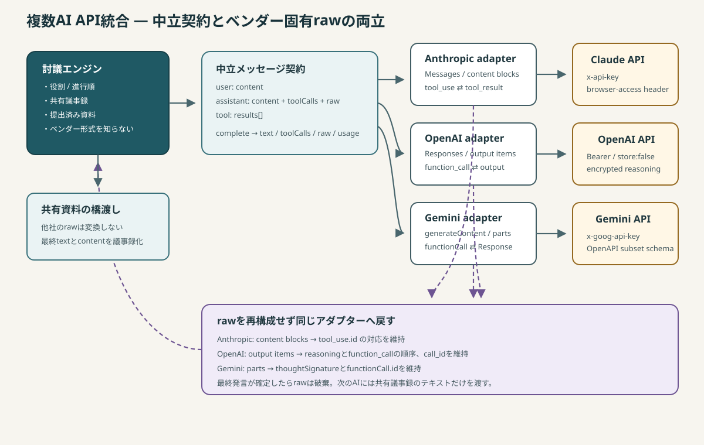

# 複数AI APIの統合設計

この文書は、Anthropic、OpenAI、Googleの異なるLLM APIを1つの討議エンジンから扱う方法だけを説明します。アプリ全体の構成は [システム構成と実装ガイド](architecture.md) を参照してください。

## 統合方針

統合の中心は「全社共通の会話API」を無理に作ることではありません。討議エンジンが必要とする最小の契約だけを中立化し、ツール往復中に必要なベンダー固有情報は `raw` として保存して同じアダプターへ戻します。



この分離により、討議エンジンはClaude、GPT、Geminiのメッセージ形式、認証ヘッダー、ツールスキーマ、推論情報を知りません。一方、アダプターは討議の役割や進行順を知りません。

## 共通プロバイダー契約

`src/llm/index.js` の `PROVIDERS` に登録される各プロバイダーは、次の形を持ちます。

```js
{
  id,                 // 保存キーと選択値に使う安定ID
  label,              // UI表示名
  vendor,             // ベンダー表示名
  defaultModel,
  keyPlaceholder,
  consoleUrl,
  listModels({ apiKey, signal }),
  complete({
    apiKey,
    model,
    system,
    messages,
    tools,
    maxTokens,
    signal,
  }),
}
```

`complete()` の戻り値は全社で共通です。

```js
{
  text: string,
  toolCalls: Array<{ id, name, input, geminiId? }>,
  raw: unknown,
  usage: { input: number, output: number },
}
```

討議エンジンが渡す中立メッセージは3種類だけです。

```js
{ role: "user", content: string }

{
  role: "assistant",
  content: string,
  toolCalls: ToolCall[],
  raw: unknown,
}

{
  role: "tool",
  results: Array<{
    id: string,
    name: string,
    content: string,
    isError?: boolean,
    geminiId?: string,
  }>,
}
```

## `raw` が必要な理由

`raw` は単なるデバッグ情報ではなく、ツール呼び出しを継続するための必須状態です。モデルが返したアシスタントターンを、テキストと関数名だけから組み直してはいけません。

| プロバイダー | `raw` の内容 | 保持しない場合の破損 |
|---|---|---|
| Anthropic | `content` ブロック配列 | `tool_use.id` と `tool_result.tool_use_id` の対応を失う |
| OpenAI | Responses APIの `output` 配列 | reasoningとfunction callの順序、`call_id` の関連を失う |
| Gemini | candidateの `parts` 配列 | Gemini 3系の `thoughtSignature` を失い、関数応答を継続できない |

`runTurn()` はアダプターの応答をそのまま `messages[].raw` へ入れます。次回の同じ発言内API呼び出しで、各アダプターがその値をベンダー形式へ戻します。`raw` は発言が確定すると捨てられ、次の討議参加者へは渡りません。

## 討議ターンとAPI会話の境界

複数AIを束ねるもう1つの重要点は、APIの会話履歴と討議の履歴を分けていることです。

```text
討議ターンA
  共有議事録を user メッセージとして送信
  → AIがtool call
  → ツール結果を同じベンダー会話へ返す
  → 最終発言を取得
  → ベンダー会話は破棄

討議ターンB
  Aの最終発言を含む共有議事録を、新しい user メッセージとして送信
  → 必要なら新しいツール会話
```

したがって、Claudeが取得した資料をGeminiへ共有するときに、Anthropicのブロック形式をGemini形式へ変換する必要はありません。最終発言と資料を中立なテキストとして共有議事録へ載せるだけです。この構造が、役割とプロバイダーを自由に組み替えられる理由です。

## ベンダー別の変換

### Anthropic Messages API

実装は `src/llm/anthropic.js` です。

- endpoint: `POST /v1/messages`
- 認証: `x-api-key`
- ブラウザ直接呼び出し: `anthropic-dangerous-direct-browser-access: true` が必須
- system: `cache_control: { type: "ephemeral" }` 付きtext block
- tool定義: `{ name, description, input_schema }`
- assistant履歴: 受信した `content` blocksをそのまま返す
- tool結果: `user` roleの `tool_result` block

同じ役割system promptを繰り返すため、systemをプロンプトキャッシュ対象にしています。

### OpenAI Responses API

実装は `src/llm/openai.js` です。Chat CompletionsではなくResponses APIを使います。

- endpoint: `POST /v1/responses`
- 認証: `Authorization: Bearer ...`
- system: `instructions`
- 会話: `input` 配列
- tool定義: `{ type: "function", name, description, parameters, strict: false }`
- tool call: `output` 内の `function_call`
- tool結果: `function_call_output`
- 対応ID: `function_call.id` ではなく `function_call.call_id`
- 保存: `store: false`

推論文脈は `include: ["reasoning.encrypted_content"]` で暗号化内容を受け取り、`output` 配列ごと次のリクエストへ返します。非対応モデルが関連エラーを返した場合、そのモデルだけ `Map` に記録し、`include` とreasoning itemを外して1回再送します。モデルを変更すると再挑戦します。

`temperature`、`max_tokens`、`reasoning_effort` は意図的に送りません。モデル種別ごとの非互換を避け、推論モデルの既定動作を使うためです。

### Gemini `generateContent`

実装は `src/llm/gemini.js` です。

- endpoint: `POST /v1beta/models/{model}:generateContent`
- 認証: `x-goog-api-key`
- system: `systemInstruction.parts`
- 会話: `contents`
- assistant role: `model`
- tool定義: `tools[].functionDeclarations`
- tool結果: `user` roleの `functionResponse`

`parts` は `thoughtSignature` を含みうるため、そのまま次のmodelターン履歴へ戻します。`thought: true` のtext partは内部思考として最終発言テキストから除外します。

Geminiは思考トークンも `maxOutputTokens` を消費するため、指定値にかかわらず最低8192を確保します。

## ツールスキーマの一元化

関数ツールの業務定義は `src/tools/tool-defs.js` に次の中立形式で1回だけ書きます。

```js
{
  name,
  description,
  parameters, // JSON Schema相当
  source,
  handler,
  label,
}
```

Anthropicはこの `parameters` を `input_schema` としてほぼそのまま受け取ります。OpenAIは `toOpenAiParameters()` でトップレベルobjectを保証します。GeminiはJSON Schema全体を受け付けないため、`toGeminiSchema()` が許可キーだけを再帰的に残し、型を `STRING` / `OBJECT` のような大文字へ変換します。

ベンダーごとにツール定義を複製すると、説明、required、引数名がずれてモデル動作が変わります。変換できない機能が必要になるまでは、中立定義を唯一の正としてください。

## HTTP共通層

`postJson()` は認証ヘッダーとbodyを受け取り、次を共通化します。

- JSONのシリアライズとパース
- 一時エラーの指数バックオフ
- `Retry-After` の処理
- タイムアウトと利用者Abortの合成
- ベンダーごとに異なるエラーbodyからのメッセージ抽出
- CORS/ネットワーク断を利用者向け日本語へ変換

OpenAIの「暗号化推論を外して再送」はプロトコル固有なので、共通HTTP層ではなくOpenAIアダプターにあります。

## 新しいAIプロバイダーの追加手順

1. `src/llm/<provider>.js` を作り、共通プロバイダー契約を実装する。
2. `listModels()` の戻り値を `{ id, label }[]` に正規化する。
3. 中立メッセージをベンダー形式へ変換する。assistantの `raw` を可能な限りそのまま戻す。
4. 応答を `{ text, toolCalls, raw, usage }` へ正規化する。
5. ツール結果の対応IDとエラー表現を確認する。
6. `src/llm/index.js` の `PROVIDERS` へ追加する。UIと保存キーはこの配列から自動生成される。
7. `vite.config.js` の `CONNECT_SRC` へAPIホストを追加する。
8. `test/adapters.test.js` にfetchスタブを使った送信bodyのテストを追加する。
9. APIキー1社だけ、既存社との混在、ツール成功/失敗、中断を手動確認する。

プロバイダーIDはlocalStorageキーの一部になるため、公開後に変更すると保存済みキーとモデル選択が見えなくなります。表示名変更には `label` / `vendor` を使い、`id` は安定させてください。

## アダプター変更時のレビュー観点

- `raw` の配列順・未知フィールドを落としていないか。
- tool callのIDとtool resultのIDが、ベンダー仕様どおり対応しているか。
- エラー時にツール結果がベンダーの期待するオブジェクト/文字列型になっているか。
- system promptと通常メッセージの置き場所が正しいか。
- tool schema変換でrequired、配列items、nested propertiesが残るか。
- 中断signalがすべてのfetchに渡るか。
- APIキーや完全なリクエストbodyをログ出力していないか。
- モデル一覧から生成用途でないモデルを適切に除外しているか。
- 実装変更後に `npm test` と `npm run build` が通るか。

## テストで固定している重要挙動

`test/adapters.test.js` は実際にfetchへ渡されるbodyを捕捉し、次を固定しています。

- Anthropicのブラウザ用ヘッダー、system cache、`tool_result`
- OpenAI Responses API、平坦なtool定義、`call_id`、reasoningの順序と降格再送
- Geminiの `parts` / `thoughtSignature` 保持、schema変換、思考textの除外

`test/engine.test.js` は偽プロバイダーを注入し、tool結果の共有、`dataset` をモデルへ送らないこと、部分失敗、中断、早期終了を固定しています。アダプターの単体テストだけでは統合境界の破損を検出できないため、両方を実行してください。
