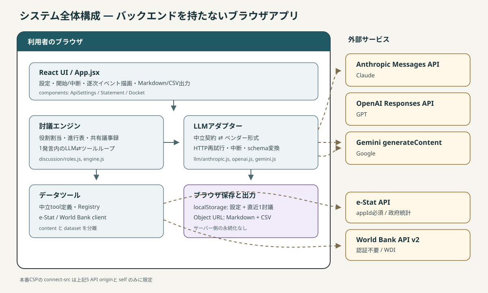
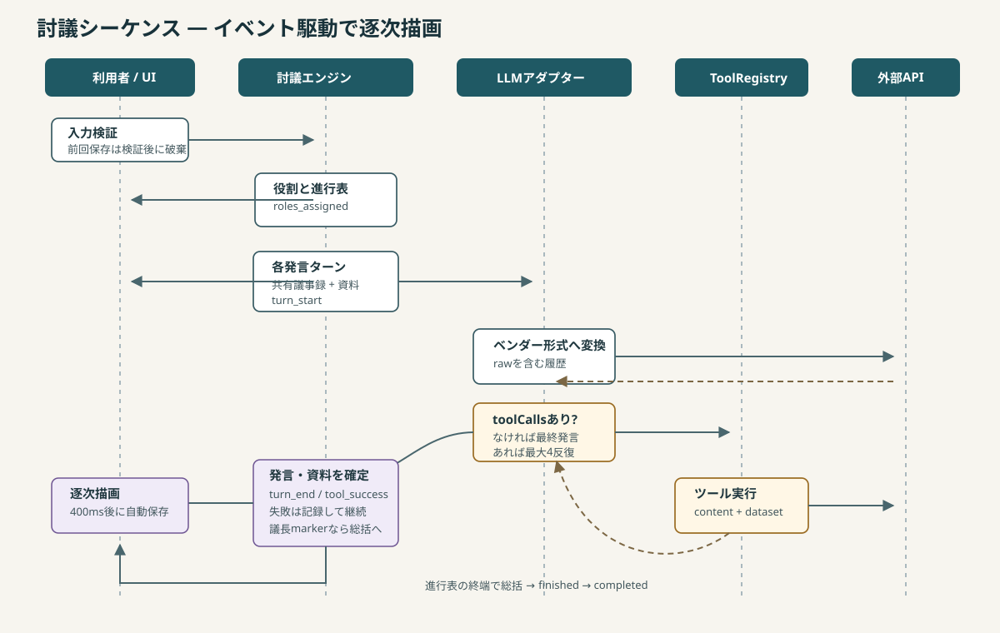

# システム構成と実装ガイド

## 目的と境界

AI討議アリーナは、複数のLLMに議長・肯定側・否定側を担当させ、必要に応じて公的統計を取得しながら討議させるシングルページアプリです。サーバー、データベース、独自認証は持たず、UI・進行制御・API呼び出し・保存・ファイル生成のすべてをブラウザで実行します。



## 技術スタック

| 区分 | 採用技術 | 実装上の用途 |
|---|---|---|
| UI | React 19 | 設定、討議進捗、発言、提出資料の描画 |
| ビルド | Vite 8 | 開発サーバー、本番バンドル、CSPの注入 |
| Markdown | `react-markdown` + `remark-gfm` | LLM発言の表示 |
| テスト | Node.js標準 `node:test` | ESMを直接importした単体・結合寄りテスト |
| 永続化 | Web Storage `localStorage` | API設定と直近セッション |
| 外部API | Anthropic / OpenAI / Gemini | 発言生成と関数ツール呼び出し |
| 公的データ | e-Stat / World Bank API v2 | 討議根拠の取得 |
| 配布 | 静的ファイル / GitHub Pages | `dist/` のホスティング |

Node.jsはVite 8の要件に合わせ、`^20.19.0 || >=22.12.0` を使用します。調査時の環境はNode.js 24.14.1、npm 11.19.0です。

## ディレクトリと責務

```text
src/
├── App.jsx                 画面状態、討議開始/中断、イベント反映、保存、出力
├── components/             表示コンポーネント
│   ├── ApiSettings.jsx     APIキー・モデル・e-Stat IDの設定
│   ├── Statement.jsx       発言カードとMarkdown描画
│   └── Docket.jsx          提出資料一覧
├── discussion/
│   ├── roles.js            役割、役割割り当て、system/フェーズ指示
│   ├── engine.js           スケジュール、発言生成、ツールループ、イベント通知
│   └── export.js           Markdown議事録とCSVの純粋な組み立て
├── llm/                    ベンダー差を吸収するアダプター層
├── tools/                  中立ツール定義と外部統計APIクライアント
├── storage/                localStorageの保護された読み書きとセッション形式
├── utils/download.js       Object URLを用いたファイル保存
└── styles/app.css          全画面スタイル
```

依存方向は概ね `App/components → discussion → llm/tools` で、保存は `App → storage` の独立した枝です。`discussion` からReactやブラウザDOMへ依存させないことで、ネットワーク無しの偽プロバイダーを注入して進行をテストできます。

## 討議の実行フロー



### 1. 開始前の検証

`App.handleStart()` はテーマとAPIキーの存在を検証します。検証に通った後でのみ、保存タイマーを止め、前のセッションを削除し、新しい討議状態を初期化します。この順番は重要です。先に削除すると、入力不備で開始できなかっただけでも前回記録を失います。

APIキーが入っているプロバイダーだけを `providerIds` として `runDiscussion()` へ渡します。1社でも実行可能で、3役への割り当ては `assignRoles()` が循環して埋めます。

### 2. スケジュール生成

`buildSchedule()` は次の順で進行表を作ります。

- 開会: 議長
- 各巡: 奇数巡は肯定→否定、偶数巡は否定→肯定
- 中間整理: `mcInterval` ごと。ただし最終巡には挿入しない
- 総括: 議長

既定値は6巡、議長の整理は2巡ごとです。中間整理で議長が `[討議終了]` を返した場合、残りの討議巡を飛ばして総括へ移ります。マーカーは表示用本文から除去されます。

### 3. 共有議事録による文脈

各発言で `buildTurnPrompt()` がテーマ、参加者、進行状況、共有議事録、提出済み資料、フェーズ指示を1つの `user` メッセージへまとめます。プロバイダー自身の過去の会話履歴をターン間で保持する方式ではありません。

コンテキスト量を抑えるため、直近6発言は全文、それ以前は各220文字へ要約ではなく機械的に切り詰めます。資料一覧も各400文字の抜粋です。ここを変更する場合は、討議の一貫性とトークンコストの両方を評価してください。

### 4. 1発言内のツールループ

`runTurn()` はモデル応答に `toolCalls` があれば、`ToolRegistry` で順番に実行して結果をモデルへ返します。最大4回の反復後はツール定義を外し、取得済み情報だけで最終発言を生成させます。ツール履歴はこの関数から外へ出しません。

成功した取得結果は同じオブジェクトを次の2か所に追加します。

- 発言の `toolUses`: その発言が参照した資料
- 討議全体の `evidence`: 後続AIへの共有とCSV出力に使う資料

ツール失敗はエラー文字列としてモデルへ返し、条件修正や方針転換をモデルに委ねます。LLM発言そのものの失敗も `turn_error` として記録し、他の参加者の進行は継続します。利用者のAbortだけは全体を停止します。

## UIとイベント連携

`runDiscussion()` は結果が返る前から `onEvent` を発行します。`App.jsx` はこれをReact stateへ反映し、進捗を逐次表示します。

| イベント | 主な発生箇所 | UI側の処理 |
|---|---|---|
| `roles_assigned` | 役割決定後 | 参加者席を表示 |
| `turn_start` | 各発言開始 | 発言者・フェーズを表示 |
| `tool_start` | ツール実行直前 | 照会中の資料名を表示 |
| `tool_success` | 取得成功 | `evidence` へ追加 |
| `tool_error` | 取得失敗 | 進捗メッセージを更新 |
| `turn_end` | 発言成功 | `statements` へ追加 |
| `turn_error` | 発言失敗 | 失敗記録へ追加 |
| `early_close` | 早期終了判定 | 現状UIでは専用表示なし |
| `finished` | 全工程終了 | 現状UIでは専用処理なし |

`runDiscussion()` 自体も完成した配列を返しますが、現UIは戻り値ではなくイベントで状態を構築します。イベント名やペイロードを変える場合、エンジンと `App.jsx` を同時に変更してください。

## 外部接続とセキュリティ境界

本番ビルド時に `vite.config.js` のプラグインがCSP metaを `index.html` へ注入し、`connect-src` を次の接続先に限定します。

- `api.anthropic.com`
- `api.openai.com`
- `generativelanguage.googleapis.com`
- `api.e-stat.go.jp`
- `api.worldbank.org`

開発サーバーではVite HMRとの互換性のためCSPを注入しません。したがって、CSPの検証は `npm run build` 後の `dist/index.html` で行います。

この構成の信頼境界はブラウザです。APIキーは暗号化せず `localStorage` に保存され、JavaScriptから読み取れます。CSPは送信先を狭めますが、XSS、悪意あるブラウザ拡張、共有OSアカウント、開発時の無制限接続を解決するものではありません。より強い秘密管理や利用者認証が必要なら、APIキーを保持するバックエンド/BFFへの移行が必要です。

## エラー処理と再試行

LLMのPOSTは `src/llm/http.js` が共通処理します。

- 408 / 409 / 429 / 500 / 502 / 503 / 529 を最大3回再試行
- 1秒から始まる指数バックオフ、最大20秒
- `Retry-After` があれば秒として尊重
- 1リクエストの既定タイムアウトは180秒
- 利用者Abortとタイムアウトを `AbortSignal.any()` で合成
- JSON形式が異なる各社エラーから利用者向けメッセージを抽出

モデル一覧のGETは疎通確認用途のため再試行しません。e-Statは30秒、World Bankは処理により30〜60秒のタイムアウトを独自に持ちます。

## 変更箇所から引く確認表

| 変更内容 | 主な変更先 | 必須確認 |
|---|---|---|
| 新しいLLMプロバイダー | `src/llm/`、`llm/index.js`、CSP | [複数AI APIの統合設計](ai-api-orchestration.md)、adapterテスト |
| 討議順・早期終了 | `discussion/engine.js` | `discussion.test.js`、`engine.test.js` |
| 役割や発言指示 | `discussion/roles.js` | 役割割当テスト、実モデルで品質確認 |
| 新しい統計ツール | `tools/tool-defs.js`、API client、CSP | toolテスト、`content/dataset` 分離 |
| 保存形式 | `storage/session.js` | version更新方針、storage/exportテスト |
| 出力形式 | `discussion/export.js` | CSV式注入、BOM、資料番号対応 |
| UIイベント | `App.jsx` と `engine.js` | 進行中・中断・部分失敗の手動確認 |

## 既知の制約と技術的負債

- 実APIを使うE2Eテストがなく、既定モデルID・CORS・ベンダー仕様の実疎通は未確認です。
- API使用量は各発言へ保存されますが、UI表示、集計、費用見積もり、Markdown出力には使われていません。
- Reactのエラーバウンダリがありません。復元データはサニタイズしますが、実行中に予期しない形のデータが入ると画面全体が落ちる可能性があります。
- 直近1討議のみ保存し、中断位置からの再実行や複数履歴の管理はできません。
- `AbortSignal.timeout()` と `AbortSignal.any()` を使うため、古いブラウザを対象にする場合は互換性確認が必要です。
- `early_close` と `finished` はイベントとして存在しますが、専用のUI通知はありません。
