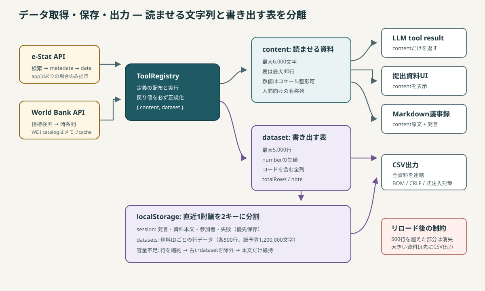

# データ取得・保存・出力

## データの流れ



このアプリでは、AIに読ませる資料と利用者が出力する表データを分離しています。ツールハンドラーは必ず次の形を返します。

```js
{
  content: string, // LLMと画面向け。短く、読みやすく整形
  dataset: {       // CSV向け。生の値と全列を保持
    columns: string[],
    rows: object[],
    totalRows: number,
    note?: string,
  } | null,
}
```

`ToolRegistry.execute()` がこの契約の境界で、ハンドラーが文字列だけを返しても `{ content, dataset: null }` へ正規化します。

## LLM向け `content` とCSV向け `dataset`

| 観点 | `content` | `dataset` |
|---|---|---|
| 主な利用者 | LLM、提出資料UI、Markdown議事録 | CSV出力 |
| 行数 | 表示は最大40行 | 最大5,000行 |
| 文字数 | 最大6,000文字 | 文字数上限ではなく行数上限 |
| 数値 | `1,234` のように読みやすく整形可 | `number` の生値を維持 |
| 列 | 人間が読む分類名を優先 | コードを含む追跡可能な全列 |

同じ文字列表現をCSVへ流用しないでください。表示の省略がデータ欠落になり、桁区切り済み数値が表計算ソフトで文字列扱いになります。

## e-Stat連携

### 提供ツール

1. `estat_search_tables` — 日本語キーワードで統計表を探す
2. `estat_get_metadata` — 分類事項と正式なコードを確認する
3. `estat_fetch_data` — 確認済みコードでデータを絞り込む

e-StatのappIdが無い場合、`ToolRegistry.definitions()` はe-Stat系ツールをLLMへ提示しません。未設定で必ず失敗するツールをモデルに選ばせないためです。

APIレスポンスは単一オブジェクトと配列が混在するため、`asArray()` で正規化します。値レコードは `@cat01` のような次元コードを通常キーへ移し、メタデータの名称を `<dimension>_name` として付加します。CSVには名称と生コードの両方を残します。

取得は `NEXT_KEY` を使ってページングし、`maxRecords` まで続けます。既定は2,000件です。`surveyYears` はLLMが指定しやすい `yyyy-yyyy` も受け、`yyyy01-yyyy12` へ変換します。

### 変更時の注意

- 絞り込みコードを推測させず、search → metadata → fetchの順を説明文で維持する。
- `filters` は自由形式objectではなく `{ key, value }[]` のままにする。3社間のschema互換性を優先した設計です。
- 取得上限に達した場合は、資料の注記に切り詰めを残す。
- APIレスポンスの `STATUS` は数値と文字列の両方を許容する。

## World Bank連携

### 提供ツール

1. `worldbank_search_indicators` — 英語キーワードでWDI指標を探す
2. `worldbank_fetch_indicator` — ISO3国コードと期間で時系列を取得する

World Bank API v2に全文検索がないため、source 2の指標カタログを最大4ページ・1ページ1,000件で取得し、ブラウザ内でAND検索します。取得済みカタログと進行中Promiseをモジュールスコープでキャッシュし、同時・反復取得を避けます。ページ再読み込みでキャッシュは消えます。

時系列は `per_page=20000` で取得し、null値を除外して年の降順に並べます。画面/LLMには直近40行、CSVには上限内の全行を渡します。

## セッション保存

保存キーには `ai-discussion.` プレフィックスを使います。主なキーは次のとおりです。

| キー | 内容 |
|---|---|
| `ai-discussion.key.<providerId>` | APIキー |
| `ai-discussion.model.<providerId>` | 選択モデル |
| `ai-discussion.estatAppId` | e-Stat appId |
| `ai-discussion.topic` | テーマ入力欄の下書き |
| `ai-discussion.session` | 軽量な討議本体 |
| `ai-discussion.datasets` | 資料IDごとの行データ |

討議本体と行データは2キーに分けます。発言ごとに大きな表を再直列化・再書き込みすることを避け、容量不足時も議事録本体を優先して残すためです。

`statements[].toolUses` と `evidence[]` は実行時に同じ資料オブジェクトを参照します。保存時は発言側を `{ id, source, label }` へ縮約し、行データの二重保存を防ぎます。

### 容量劣化の順序

1. セッション本体を先に保存する。
2. 各資料の保存行を最大500行へ切り詰める。
3. セッションJSONを含む総文字予算1,200,000文字に収まるよう、新しい資料から優先して採用する。
4. datasetsキーの保存に失敗した場合、行データだけを諦める。
5. セッション本体も保存できなければ両キーを削除し、その後の自動保存試行を停止する。

ブラウザごとに容量超過例外名が異なるため、エラー名では分岐しません。書き込みがthrowしたかだけで判定します。

### 保存タイミングと復元

`App.jsx` は状態変更を400msデバウンスして保存し、`pagehide` では同期的にflushします。タブを閉じるとReactのunmountが保証されないためです。

復元時は `SESSION_VERSION` を一致確認し、`sanitizeSession()` が配列、必須文字列、roleを検証します。未知roleを除去する理由は、UIが `ROLE_META[role].name` を直接参照するためです。datasets JSONが壊れていても本文は復元し、該当datasetだけ `null` にします。

保存時statusが `running` だった場合、画面上では `interrupted` として扱います。記録は表示できますが、途中からAPI会話を再構築して再開する機能はありません。

## Markdown議事録

`buildMinutesMarkdown()` は次を出力します。

- テーマ、出力日時、中断状態
- 役割・プロバイダー・モデル
- 全発言と発言が参照した資料
- 発言できなかった順番とエラー
- 提出資料の `content` 原文

ファイル名はテーマからOSで危険な記号と制御文字を除き、40文字へ切り詰め、日時を付加します。

## CSV出力

全資料を、資料ごとのメタ行と表を連結した1ファイルへ出力します。Markdownと同じ `evidence` 順を使うため「資料N」が一致します。

実装上の安全策は次のとおりです。

- 改行はExcel互換を意識したCRLF。
- UI側でUTF-8 BOMを付加し、日本語版Excelの文字化けを防止。
- カンマ、引用符、改行を含むセルをRFC 4180風にクォート。
- `=`、`+`、`@` で始まる文字列へ `'` を付け、CSV式注入を抑止。
- 数値はロケール整形せず、有限値だけを出力。
- 保存容量で行が減った資料には元行数と警告を出力。

CSV生成関数自体はBOMを付けません。BOMは `App.handleExportCsv()` のダウンロード直前に付ける責務分担です。

## 保存形式を変更するとき

互換性を壊す変更では `SESSION_VERSION` を更新してください。現在は旧versionを移行せず無視する設計です。既存データを維持する必要がある場合は、version別のmigrationを `sanitizeSession()` の前に追加します。

変更後は最低でも次を確認します。

```bash
node --test test/storage.test.js
node --test test/export.test.js
node --test test/tools.test.js
```

特に、行データの二重保存、古い資料からの劣化、壊れたroleの除去、CSV式注入、資料番号の一致を維持してください。
